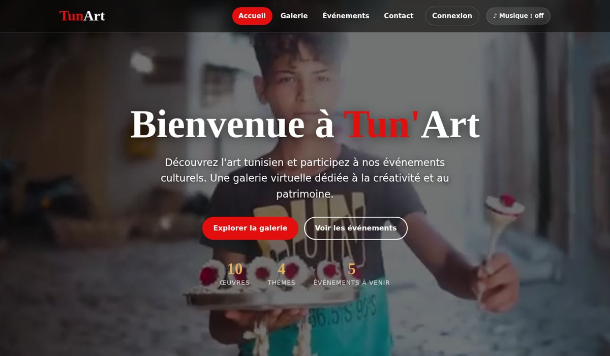
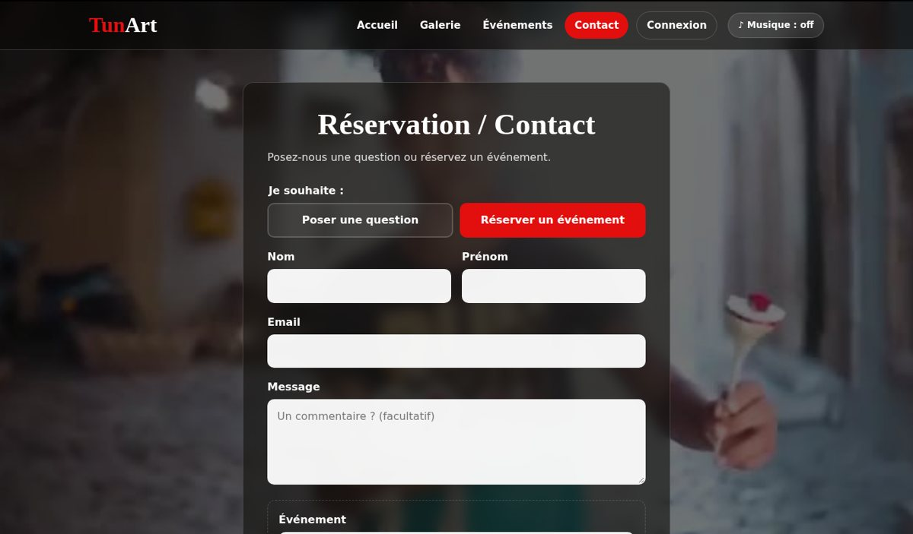
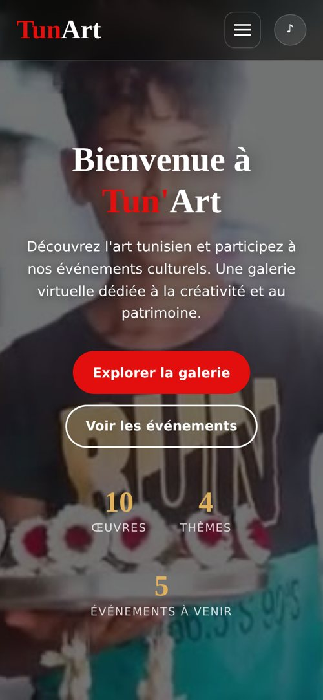

# Tun'Art — Galerie d'art virtuelle

**Une expérience web immersive dédiée à la peinture tunisienne.**

Tun'Art est un site web front-end qui met en valeur les œuvres artistiques tunisiennes à travers une galerie interactive, une navigation par thèmes et un espace consacré aux événements culturels. Les visiteurs peuvent explorer les œuvres, les visualiser en plein écran et consulter les informations de réservation.

Développé en **HTML5, CSS3 et JavaScript natif**, le projet privilégie une interface soignée, une architecture simple à maintenir et une expérience adaptée aux différents appareils, sans framework ni dépendance à installer.

---

## Aperçu du projet

<p align="center">
  
</p>

<p align="center">
  <em>Une interface visuelle pensée pour valoriser l'art et simplifier la navigation.</em>
</p>

## Fonctionnalités principales

### Galerie interactive
- Exploration des œuvres par thème : Marine, Médina, Portraits et Traditions.
- Affichage des œuvres dans une visionneuse plein écran.
- Navigation au clavier avec les flèches directionnelles et fermeture avec `Échap`.

### Événements culturels
- Consultation des événements et de leurs informations.
- Classement chronologique des événements.
- Identification des événements terminés.

### Réservation et contact
- Formulaire dynamique adapté au type de demande.
- Présélection d'un événement depuis la page correspondante.
- Calcul automatique du montant selon le tarif et le nombre de participants.

### Expérience utilisateur
- Interface responsive pour mobile, tablette et ordinateur.
- Menu de navigation adapté aux petits écrans.
- Contrôle de la musique d'ambiance avec mémorisation de son état entre les pages.
- Navigation au clavier et indicateurs de focus visibles.

## Aperçu de l'interface

<p align="center">
  
</p>

<p align="center">
  <em>Galerie : exploration des œuvres et navigation par thème.</em>
</p>

<p align="center">
  
</p>

<p align="center">
  <em>Réservation : formulaire dynamique et calcul automatique du total.</em>
</p>

<p align="center">
  
</p>

<p align="center">
  <em>Responsive design : une interface adaptée aux écrans mobiles.</em>
</p>

## Choix techniques et qualité du code

| Domaine | Mise en œuvre |
|---|---|
| Architecture | Séparation du HTML, du CSS, des données et de la logique JavaScript |
| Gestion des données | Centralisation des œuvres et des événements dans `js/data.js` |
| JavaScript | Manipulation du DOM et gestion des interactions sans framework |
| Sécurité côté client | Construction des éléments DOM sans recours à `innerHTML` |
| Accessibilité | Textes alternatifs, navigation clavier, focus visible, liens d'évitement et attributs ARIA adaptés |
| Performance | Images compressées, vidéo allégée et chargement différé des images |
| Référencement | Métadonnées `title`, `description` et Open Graph pour les pages |
| Maintenabilité | Logique partagée et limitation de la duplication du code |
| Compatibilité | Interface responsive et prise en compte de `prefers-reduced-motion` |

## Architecture du projet

```text
Virtual_art_gallery/
├── index.html
├── gallery.html
├── evenements.html
├── contact.html
├── 404.html
├── css/
│   └── style.css
├── js/
│   ├── data.js
│   └── main.js
├── assets/
│   ├── images/
│   ├── video/
│   ├── audio/
│   └── favicon/
├── docs/
│   └── screenshots/
└── LICENSE
```

**Organisation du code :**
- `index.html`, `gallery.html`, `evenements.html`, `contact.html` : structure des pages.
- `css/style.css` : styles et mise en page du site.
- `js/data.js` : données des œuvres et des événements.
- `js/main.js` : interactions, navigation, galerie, musique et formulaires.
- `assets/` : ressources visuelles et sonores.
- `docs/screenshots/` : captures d'écran utilisées dans la documentation.

## Installation et exécution

### Prérequis
- Un navigateur web moderne.
- Git, pour cloner le dépôt.

### Lancer le projet localement

```bash
git clone <URL_DU_DEPOT>
cd Virtual_art_gallery
```

Ouvre ensuite `index.html` dans ton navigateur.

Pour utiliser un serveur HTTP local :

```bash
python -m http.server 8000
```

Accède au site à l'adresse :

`http://localhost:8000`

Aucune installation de framework ou de dépendance supplémentaire n'est nécessaire.

## Déploiement avec GitHub Pages

1. Ouvre le dépôt sur GitHub.
2. Accède à **Settings → Pages**.
3. Sélectionne la branche `main` et le dossier `/ (root)`.
4. Enregistre la configuration.

Après publication, le site sera accessible à l'adresse proposée par GitHub Pages, généralement sous la forme :

`https://<nom-utilisateur>.github.io/<nom-du-depot>/`

## Limites actuelles et évolutions possibles

Tun'Art est actuellement un **prototype front-end**. Les fonctionnalités présentées dans l'interface ne constituent pas un système de réservation connecté à un serveur.

- **Formulaires :** la validation et le calcul du montant sont effectués côté navigateur. Aucun message ni réservation n'est enregistré sur un serveur.
- **Authentification :** aucune gestion réelle de comptes utilisateurs n'est mise en place.
- **Événements :** les événements présentés sont fictifs et servent à la démonstration.

### Pistes d'amélioration
- Ajouter un backend et une base de données pour gérer les œuvres, les événements et les réservations.
- Mettre en place un espace d'administration.
- Ajouter une interface multilingue en français, en arabe et en anglais.
- Intégrer un système de confirmation des réservations et, si nécessaire, un paiement en ligne sécurisé.

## Crédits et licence

Le code source est distribué sous licence **MIT**. Consulte le fichier `LICENSE` pour les conditions applicables au code.

Les peintures, la vidéo et l'enregistrement musical utilisés dans le projet restent soumis aux droits de leurs auteurs respectifs. Leur présence dans cette démonstration pédagogique ne signifie pas qu'ils sont libres de droits. Toute diffusion publique doit respecter les autorisations et licences applicables.

## Auteur

**Tun'Art Team**

Projet front-end réalisé dans un objectif pédagogique, mettant en pratique le développement web, la conception d'interface utilisateur, l'interactivité JavaScript et les bonnes pratiques de structuration du code.

---

<p align="center">
  <sub>Conçu pour explorer l'art. Développé pour offrir une expérience web soignée.</sub>
</p>